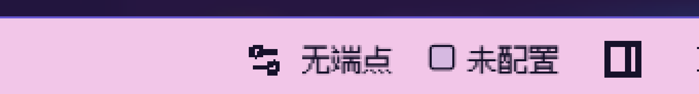
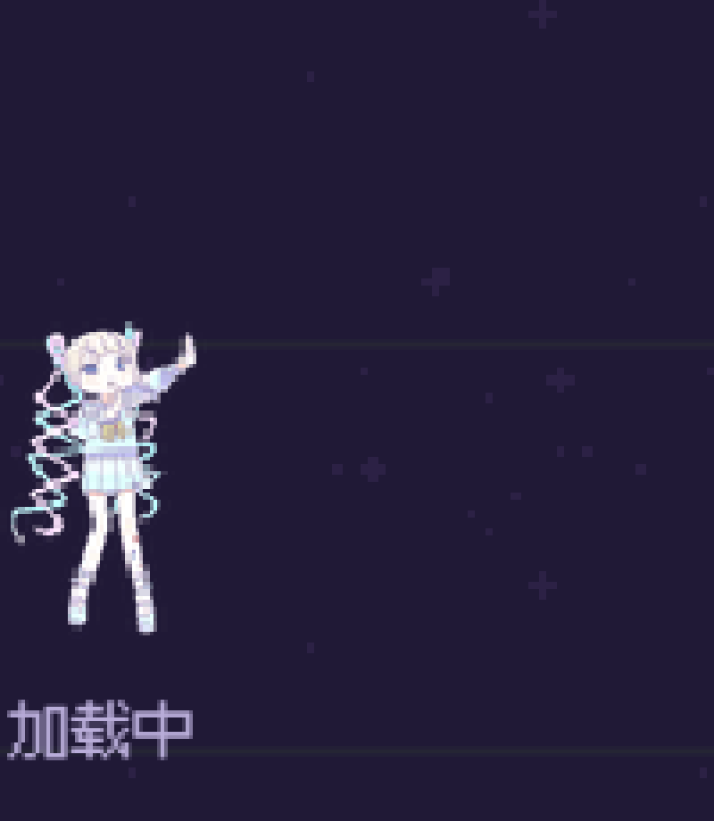
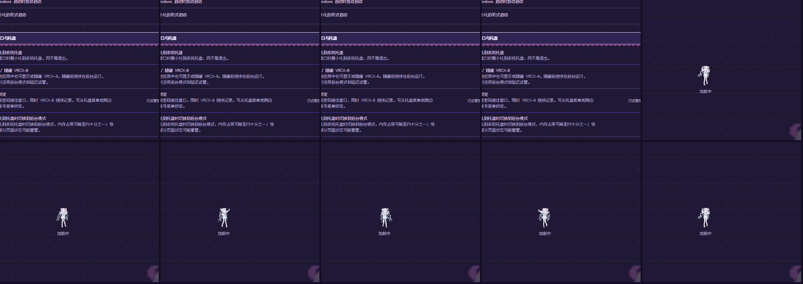
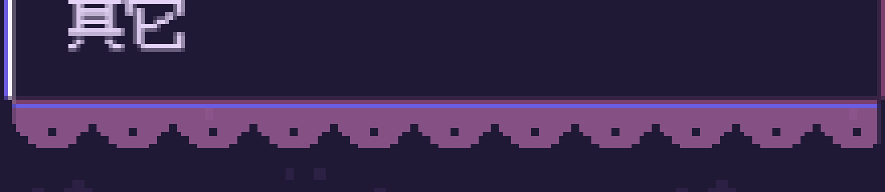
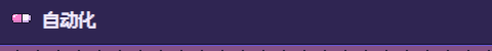
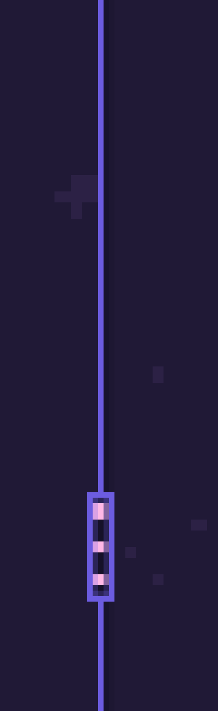
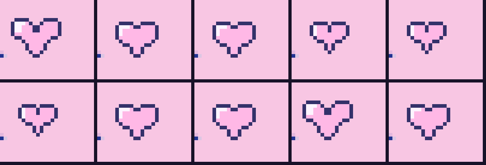

# R9.7 实机验收记录（Windows / VRCX-0）

- 日期：2026-10-13 11:2x–11:4x（Asia/Shanghai）
- 目标目录：`C:\Users\tangh\Documents\GitHub\theme-preview\jirai-kei-theme`（恰好 4 文件）
- 产物：`theme.css` 1,024,259 B `C8FAB4A5…` / `README.md` 3,469 B `B73DEB4F…` / `theme.json` 688 B `9814DA99…` / `preview.webp` 45,310 B `0603E7BA…`
- **结论：R9.7 的 7 项交付（Q1–Q7）在实机上全部通过。**

## 实机环境（实测，非推断）

| 项 | 值 | 取法 |
|---|---|---|
| 应用 | VRCX-0（Tauri） | — |
| **进程名** | **`vrcx-0.exe`** | `Get-Process`。注意不是 `VRCX`——用错名字会得到"未运行"的假阴性 |
| 数据目录 | `%APPDATA%\VRCX-0` | `VRCX-0.json` / `.sqlite3` / `error-log.txt` 所在处 |
| 渲染内核 | CEF 146.0.7680.179 | `%APPDATA%\VRCX\LastCefVersion` |
| 屏幕缩放 | **125%**（DPI 120） | `GetDpiForWindow(vrcx-0 主窗口)` |
| 分辨率 | 2048×1152 | `GetSystemMetrics` |

## 取证方法

窗口当时是最小化的（截图只有 159×27），所以：

1. `ShowWindow(SW_RESTORE)` 还原窗口（**对实机的唯一状态改动**）。
2. 导航用 UI Automation：找到目标 `ListItem` → `ScrollItemPattern.ScrollIntoView()` → 取 `ClickablePoint`。
3. **点击前一律校验 `GetForegroundWindow()` 就是 VRCX 主窗口**，不满足直接放弃点击，避免误操作其他窗口。点击用 `SetCursorPos` + `mouse_event`，事后复原鼠标位置。
4. 画面用 **`PrintWindow(hwnd, hdc, 2)` 只截 VRCX 窗口本体**。**禁止全屏截图**：实测全屏会把用户当时开着的其它窗口一并拍下（含私人聊天内容）。
5. 需要抓瞬时状态的（加载动画）改用 `CopyFromScreen` 只截窗口中心区域连拍，间隔约 170 ms。

全程未修改任何设置项、未输入任何内容。

## 逐项结果

### Q1 AI 助手头部 — 通过（`q1-ai-header-5x.png`，5×）

打开 AI 助手后，头部为**一行**粉色条：左侧标题、右侧状态。`无端点`、`未配置` 前的状态点均为**方形描边点**，在粉底上清晰可读。这同时验证了本版新增的修复：源类 `bg-muted-foreground/50` 在粉条上几乎不可见，改后加 1px 深色描边 + `border-radius:1px`，与主题既有的方形状态灯一致。



### Q2 加载动画 — 通过（`q2-loader-dance-4x.png`、`q2-loader-burst-grid.png`）

点击「关系时间轴」后立刻连拍 10 帧：第 5 帧起稳定出现**像素小人跳舞 + 「加载中」**，姿势逐帧变化（steps 跳帧动画）。小人即是本版 A 类加载的 56×72 PNG sheet。
注：双人关系页渲染过快（页面框架瞬时出现），10 帧内未捕获到加载态；同类加载已由关系时间轴证实。





### Q3 效果覆盖 — 通过

工具页与设置页的卡片**完全同款**：像素边框、双色药丸、外挂蕾丝齐备，不再是只有设置页才有主题。下图是工具页左侧分类 rail 的底部（`其它` 下方），与设置页 rail 同款外挂蕾丝：



### Q4 蕾丝朝向 — 通过（`q4-lace-5x.png`，5×）

卡片标题栏下沿：**蕾丝顶部贴在标题栏底边，扇贝尾巴朝下，尾巴后面没有多余的 border**——正是用户指出的正确朝向（旧版是蕾丝在内、尾后又压一条边）。


### Q5 双色药丸 — 通过（`q5-charm-3x.png`，3×）

卡片标题前是粉+白**双色药丸**挂饰（16×8 五色像素图，用户选定的 #3 方案）。



### Q6 分隔条 — 通过（`q6-splitter-grip-8x.png`，8×）

群组收藏页竖向分隔条，逐行扫描结果：

- x=644 处**恒为 1px 宽**，颜色 `rgb(108,92,224)` = `#6c5ce0`，从 y≈130 延伸至 y≈1030；
- y≈570–580 处线宽变 5px，即握把；8× 特写下可见**方角框内三个竖向粉色 2×2 点**。



### Q7 品牌心 — 通过（`q7-brand-heart-10frames.png`，9×）

连拍 10 帧测得心的物理边界框：

```
宽 13,12,12,11,11,11,12,12,13,12   → 只有 11/12/13 三档
高 11,10,10, 9, 9, 9,10,10,11,10   → 只有  9/10/11 三档
```

÷1.25 缩放 = CSS `8.8×7.2 / 9.6×8 / 10.4×8.8`，**精确对应 9×7 / 10×8 / 11×9**。三条排他性证据：没有任何一帧接近旧版大号的 22.75 物理 px；实测宽高比宽>高（旧版三副心是正方形）；每帧左上角都有白色高光。



用户已拍板：**保持 9×7 / 10×8 / 11×9，不改 2×**（代价是大号比 R9.6d 的 18.2 CSS px 小约 40%）。

## 未覆盖的同类位置（记录，非缺陷）

dashboard 内嵌工具 rail、WristFeedNotificationsDialog、主题自定义 CSS/开发者区块、DevKitPanel、纯文本列表分组头、无边框的普通卡片。这些位置本轮有意未加主题，等用户点名再处理。

## 已知限制

- 实机 125% 缩放：1 CSS px = 1.25 物理 px，**任何 1:1 像素图都会出现单格宽窄交替**（相邻格 1px/2px 抖动）。这是缩放比例的物理结果，不是 CSS 缺陷；只有整数倍缩放（100%/200%）或把每个视觉像素做成 4 CSS px 才能完全均匀。
- tools/settings 卡片标题因药丸挂饰右移、chevron 相应位移，属设计取舍。
- 助手动作区头部 33px，与全局 30px 条略有差异（按钮本身 32px）。
